
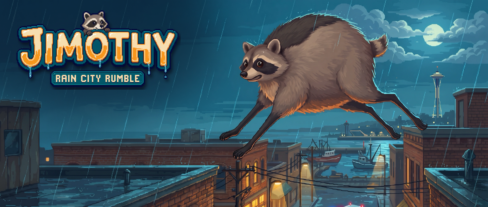

<h3 align="center">One very round raccoon. One very wet city. Every friend coming home.</h3>

  <a href="https://jimothythegame.com"><b>▶ Play the Ballard demo in your browser</b></a>
  &nbsp;·&nbsp;
  <a href="https://github.com/relghazi/jimothythegame/releases/latest"><b>⬇ Download for Windows, macOS, Linux</b></a>

---

Seattle's tourist season starts Saturday, and the whole world is watching, because a round raccoon from Ballard went viral. The mayor wants a spotless city. Animal Control's Chief Barbara Mulch launches **Operation Clean Sweep**, and overnight every raccoon in the alley is rounded up and caged for a one-way trip out of town.

Except one. Jimothy slept through the raid inside a dumpster.

**Jimothy: Rain City Rumble** is a 2D painted pixel-art platformer about crossing Seattle, neighbourhood by neighbourhood, in the rain, to bust your friends out of Animal Control trucks. Climb drainpipes and scaffolds, pounce across rooftops, run along power lines, ride the lock boats, dive head-first into bins for snacks, and stay out of sight: every tourist has a phone, and the more chaos you cause, the faster the vans come.

## The Ballard demo

The first neighbourhood, finished: Ballard's rooftops and brick storefronts, Market Street, the Shilshole marina, the Ballard Locks and the fish ladder, and a secret under it worth finding. It teaches every move as you meet it, and it's the art standard every other level will be brought up to.

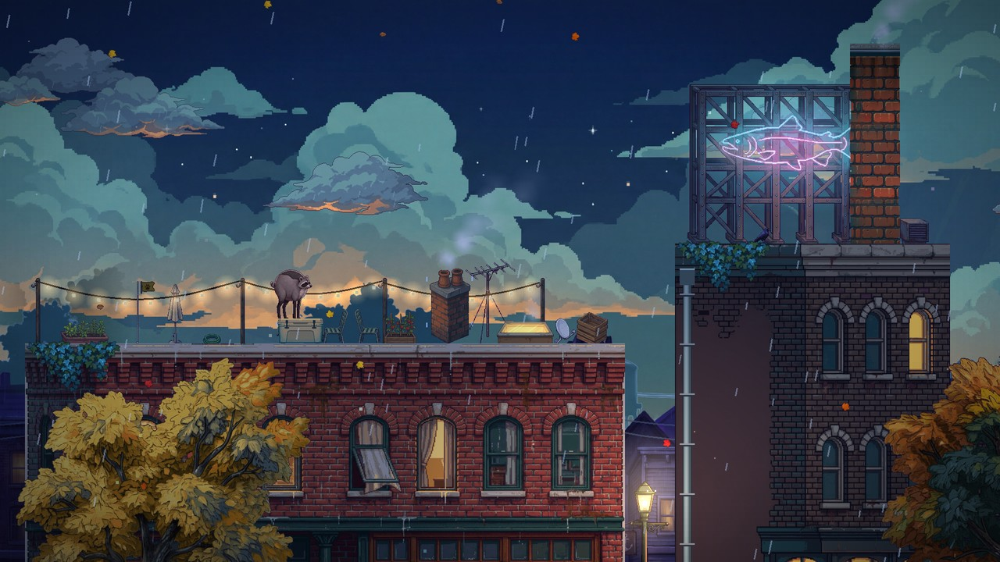

## Across the city

Nine neighbourhoods, each with its own trick, its own friend to rescue and its own weather. Ballard is done; these are concept paintings for the rest, made to the same art bible.

| | | |
|:---:|:---:|:---:|
| 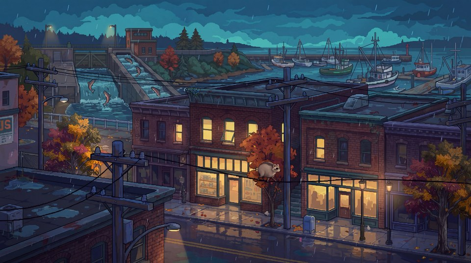 **Ballard** Home turf. Wet rooftops, the marina, the Locks. | 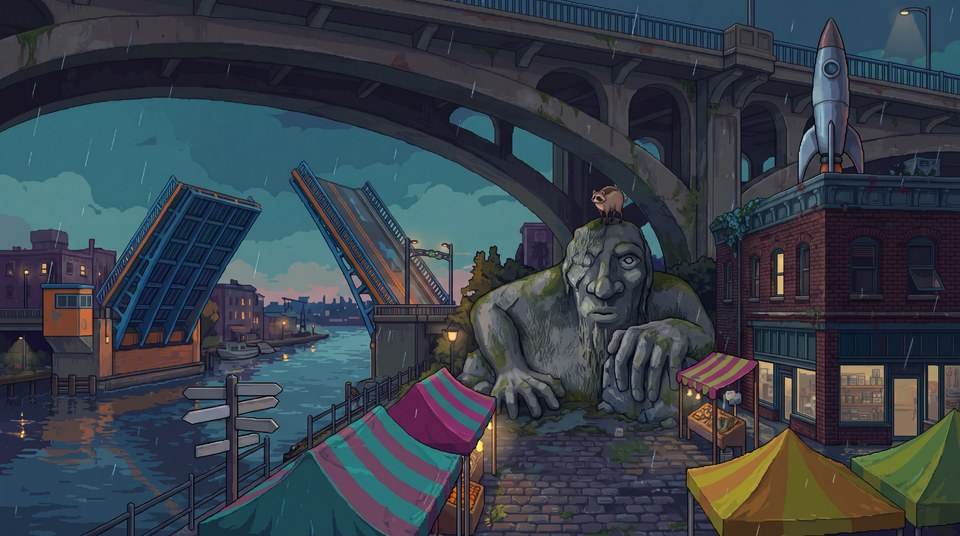 **Fremont** The bascule bridge, the Sunday market, and a Troll with a lookout on his head. | 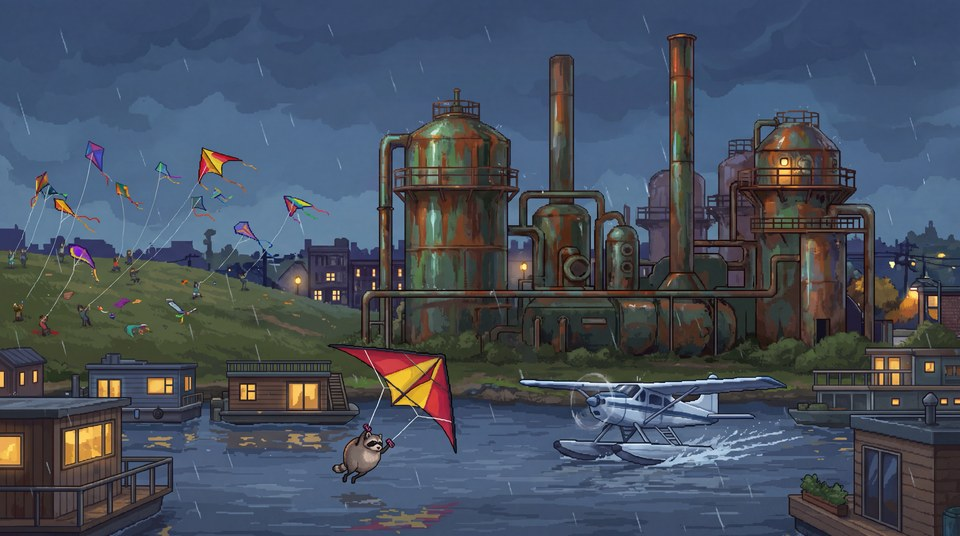 **Gas Works & Lake Union** Rusted towers, stolen kites, float planes. |
| 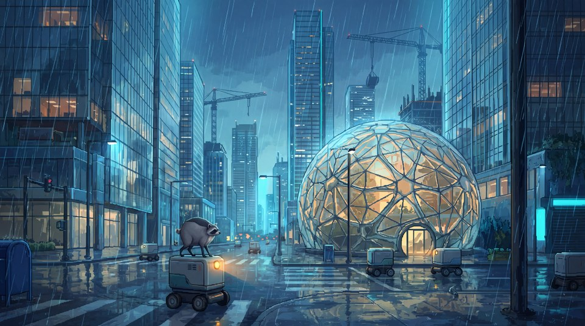 **South Lake Union** Glass, cranes, and delivery robots that don't brake. | 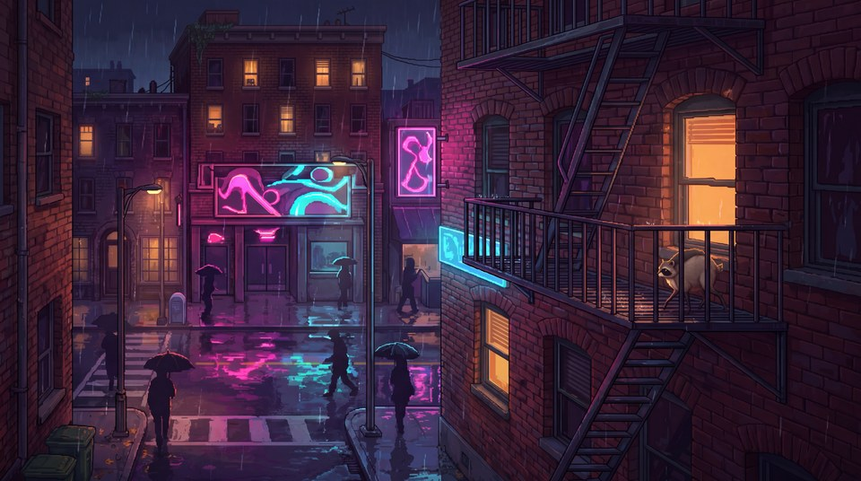 **Capitol Hill** Neon nights. The light gives you away. | 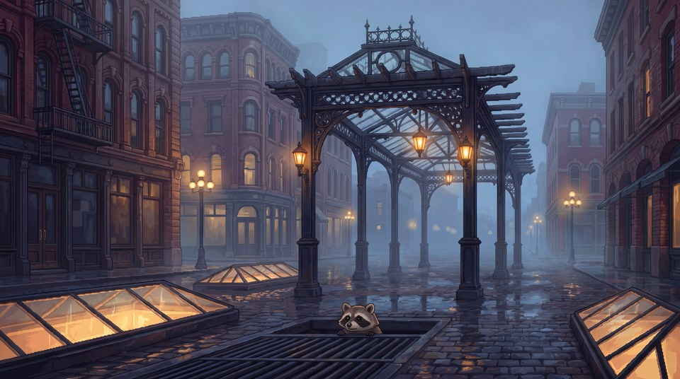 **Pioneer Square** Down into the old city under the streets. |
| 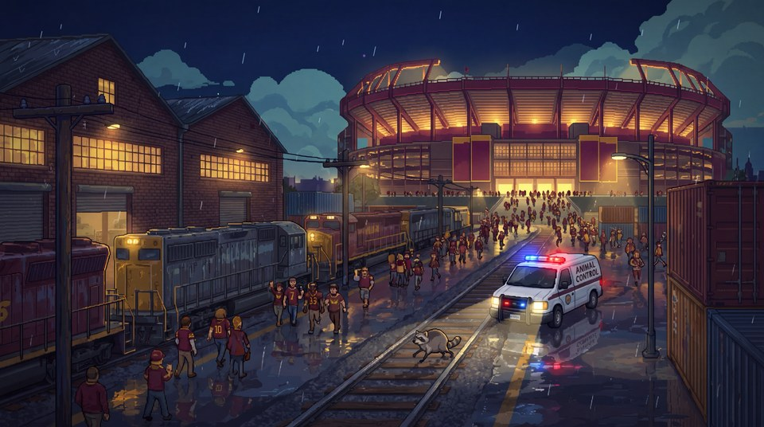 **SoDo** Game night. Outrun the van. | 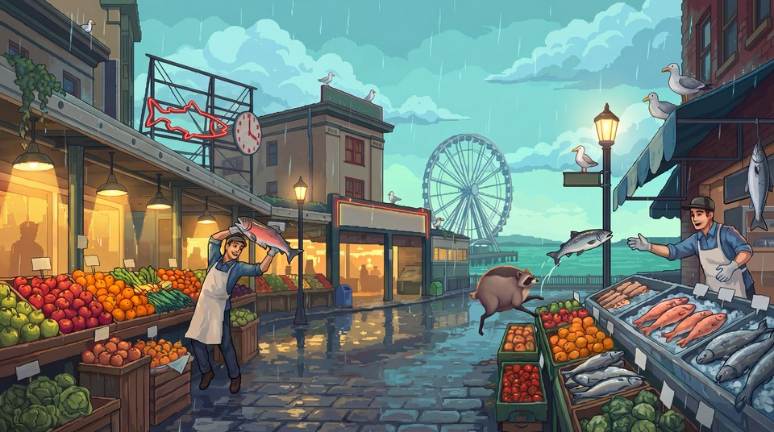 **Pike Place & the Waterfront** Flying fish, wet stone, bold gulls. | 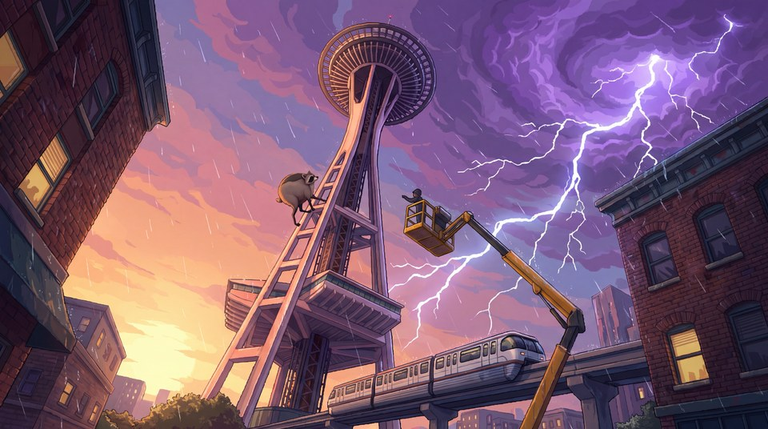 **Seattle Center** Up the Needle in a storm. Chief Mulch is waiting. |

## What's in the full game

- **9 neighbourhoods** from Ballard to the top of the Space Needle, plus **3 hidden levels**.
- **Rescue your crew.** Every friend you free teaches you a new move.
- **3 boss fights:** a lookout on the Fremont Troll, a van chase through SoDo, and Chief Mulch on the Needle.
- **Collect it all:** shinies, lost phones and secret case files in every level; outfits for Jimothy.
- **Secrets everywhere:** hidden walls and rooms, Sasquatch sightings, and a crow union you can recruit.
- **Rain is a mechanic:** wet metal is slick, puddles splash and slow you, downpours hide you.
- **Go viral, get caught:** tourists film your chaos; fill the meter and Animal Control sends everyone.
- **Play it again:** time trials with medals, plus Downpour, Viral and Hard modes.
- **Your den:** a back yard in Ballard with a snack shop, a jukebox and trophies.

## Design

- **A real raccoon.** Jimothy is based on the Ballard raccoon who went viral in July 2026: "a furry ball perched on unusually long legs", almost no neck, a stub of a tail. The character model is built on that silhouette so he's recognisable at a glance.
- **Teach by doing.** No tutorial screens: each move is introduced where failing costs a few steps, with a chalk hint that keeps coming back until you've actually used the move.
- **Never stuck for the wrong reason.** Jimothy runs over kerbs, vaults ledges just above his feet, ducks under parked cars on his own, and hops up stairs and weirs. What stops him is meant to (a climb, a gap, a guard).
- **Feel first.** Snappy acceleration, coyote time and jump buffering, a variable jump, a sprint that builds on long runs, a pounce that refills on food, a belly bounce off awnings, power lines to run on, springy clotheslines, a zipline.
- **Two planes.** The pavement is a continuous lane in front of the buildings; roofs are ledges you can jump up to from below, drainpipes climb them, and only things that really stand in a street (cars, scaffolds, a gate) block you.
- **Checkpoints about every 60 tiles**, so a capture or a drowning never sends you far back.

## Art direction

- **Painted pixel art** in the spirit of Dave the Diver: soft cel shading in three or four tones per material, deep coloured shadows (never black), warm practical lights against cool night, a wet sheen on everything.
- **One palette per neighbourhood** so a single screenshot names the place: Ballard is warm brick, teal water and sodium-amber lamps at blue hour.
- **Real-world scale:** one metre is 30 pixels (90 at the art's 3x density), so a car, a lamp, a storey and a raccoon sit right next to each other.
- **Imperfect, never deformed:** old buildings are plumb but honestly worn (a chipped cornice, a missing brick, moss in a gutter); stone edges are rounded and chipped; modern buildings stay crisp.
- **Every structure painted to its silhouette:** each building, wall and pier is a painting made for its exact shape, so nothing floats, nothing is cut in half, and every ledge you see is one you can stand on.
- **Depth:** a near foreground, the street, the buildings, a hazy across-the-street row, region backdrops, drifting clouds and a sky, each moving at its own speed.

## Tech

- **Godot 4.7, GDScript only.** 640×360 base resolution with art drawn at 3× density and shown pixel-perfect.
- **Levels from ASCII maps** generated by small Python tools, so a level's layout, art set and tests all come from one source.
- **An art pipeline built around the game:** paintings are generated to guide images of each structure's exact shape, keyed, fitted to their collision and quantised; a building kit assembles masonry, caps and dressing; vehicles and props get collision traced from their drawings.
- **Original music and sound** (a grunge title theme and a hip-hop track about Jimothy), with the title animation locked to each song's beat.
- **Tested headless:** 37 automated test scenes play through the moves, the tutorial, every new mechanic, the boats, the secrets and the menus on every change.
- Desktop (Windows, macOS, Linux) and the browser.

## Controls

| Action | Keyboard | XBOX | PlayStation | 8BitDo / Switch (SNES labels) |
|---|---|---|---|---|
| Move / climb | WASD or arrow keys | Left stick or D-pad | Left stick or D-pad | Left stick or D-pad |
| Jump | Space or K | A | Cross | B (bottom) |
| Pounce | J | X | Square | Y (left) |
| Scurry (hold) | Shift or L | RB or LT | R1 or L2 | R or ZL |
| Rummage (hold, at a bin) | S or Down (or R) | D-pad or stick down (or Y) | D-pad or stick down (or Triangle) | D-pad or stick down (or X) |
| Hide / interact | E | B | Circle | A (right) |
| Pause | Esc or P | Menu | Options | + |

Buttons go by position, so every pad plays the same: jump is always the bottom face button. XBOX, PlayStation (DualSense, DualShock 4), 8BitDo (in any mode), Switch Pro and Steam controllers are recognised and the prompts show their own buttons; any other pad can be set up button by button under Settings > Controls, which also shows a picture of your controller or keyboard with every action on it.

## Status

The Ballard demo is out. The other eight neighbourhoods are playable in development and getting the same art pass one by one; the web build on [jimothythegame.com](https://jimothythegame.com) updates as new versions land.

Inspired by a real Ballard raccoon who briefly became the most famous animal in Seattle. All characters, places, news outlets and brands in the game are fictional; all art, music and sound are original.

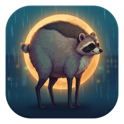 A game by Reza Elghazi · © R3Z Games

